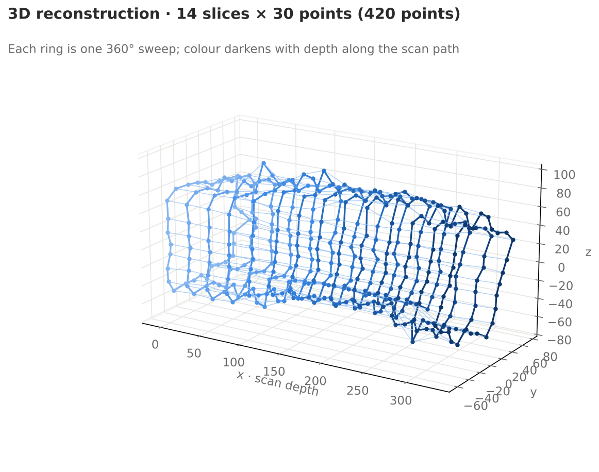
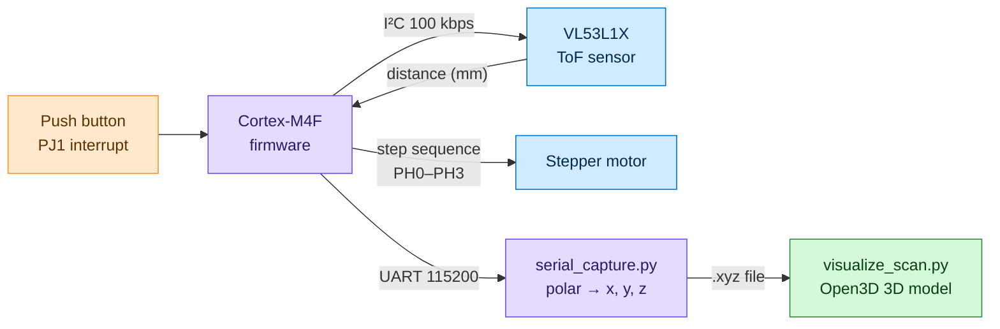
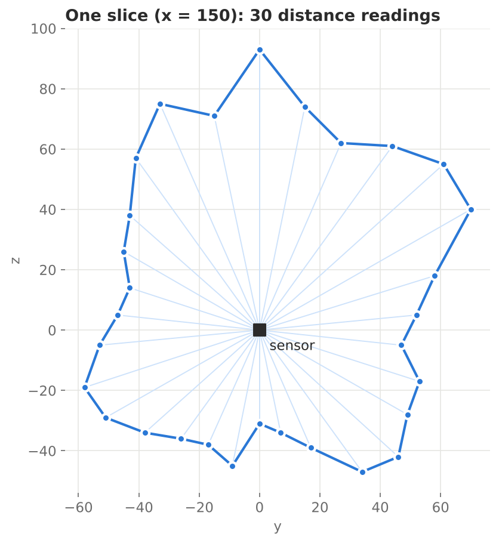

<div align="center">

# Embedded LiDAR Scanner

### A rotating time-of-flight laser sensor that maps a space into a 3D point cloud, from bare-metal firmware to 3D visualization

-00599C?style=for-the-badge&logo=c&logoColor=white)


<br/>



</div>

---

## Overview

This project is a low-cost 3D scanner built around a **VL53L1X time-of-flight (ToF) laser distance sensor** mounted on a **stepper motor**. The motor spins the sensor in a full circle, taking distance readings at fixed angles. Each sweep captures one 2D "slice" of the space around it. Moving the scanner forward and repeating the sweep builds up slice after slice, and a Python program stitches them together into a **3D model** you can rotate and explore.

The project covers the full embedded pipeline:

- **Firmware** written at the register level in C on an Arm Cortex-M4F microcontroller
- **Communication** over I²C (sensor) and UART (PC link)
- **Data processing** in Python, converting polar measurements into 3D coordinates
- **3D visualization** of the result as a point cloud and wireframe with Open3D

---

## How It Works



| Stage | What happens |
|:--|:--|
| **1. Trigger** | The board sleeps in low-power mode (`WFI`) until the onboard button fires a GPIO interrupt. |
| **2. Boot sensor** | The firmware boots the VL53L1X over I²C, initializes it and starts ranging. |
| **3. Measure** | For each of 16 angles, it waits for a reading, sends the distance over UART and blinks an LED as confirmation. |
| **4. Rotate** | The stepper advances 22.5° (128 motor steps) to the next angle. |
| **5. Unwind** | After a full 360° sweep, the motor spins back one full turn so the sensor cable doesn't tangle. |
| **6. Convert** | On the PC, each distance and its angle are converted into a 3D point and saved to an `.xyz` file. |
| **7. Visualize** | Open3D loads the points, connects each slice into a ring and links neighbouring slices into a wireframe. |

---

## From Distance to 3D Point

Each reading is a distance `r` measured at a known angle `θ`. The Python script turns it into Cartesian coordinates. The x-axis is the direction the scanner moves between slices:

```text
θ = (step / 512) × 2π        angle of the sensor for this reading
y = r × cos(θ)
z = r × sin(θ)
x = slice number × 250 mm   forward displacement between sweeps
```

<div align="center">


*One slice of the scan: each ray is a single distance reading taken as the sensor rotates.*
</div>

---

## Hardware

| Component | Role | Connection |
|:--|:--|:--|
| **TI MSP432E401Y** (Arm Cortex-M4F, TM4C1294 family) | Main microcontroller | — |
| **VL53L1X** time-of-flight sensor | Laser distance measurement | I²C0: **PB2** (SCL), **PB3** (SDA), I²C address `0x29` |
| Sensor shutdown line | Hardware reset of the sensor | **PG0** (XSHUT) |
| **Stepper motor** + driver | Rotates the sensor | **PH0–PH3** (4-phase full-step sequence) |
| Onboard push button | Starts a scan | **PJ1** (falling-edge interrupt) |
| Onboard LED | Flashes on every measurement | **PN1** |
| USB serial link | Streams data to the PC | UART, **115200 baud** |

---

## Firmware Highlights

The firmware (`firmware/scanner_firmware.c`) is written directly against the microcontroller's registers, with no high-level hardware abstraction layer.

| Feature | How it's done |
|:--|:--|
| **I²C setup** | Enables the I²C0 clock and Port B, sets PB2/PB3 to their alternate function with open-drain on SDA, and configures the timer for a 100 kbps bus. |
| **Interrupt-driven start** | Configures PJ1 for a falling-edge interrupt, enables IRQ 51 in the NVIC with priority 5, and waits with the `WFI` instruction to save power. |
| **Stepper control** | Drives a 4-phase full-step pattern (`1100 → 0110 → 0011 → 1001`) on Port H, with SysTick delays setting the speed. |
| **Sensor driver** | Uses the VL53L1X API to boot the sensor, start ranging, poll for data ready and read distance, signal rate, ambient rate and range status. |
| **Clocking and timing** | Configures the PLL for the system clock and SysTick for precise millisecond delays. |

> **Dependencies:** the firmware uses the ST VL53L1X Ultra Lite Driver (`vl53l1x_api.h`) and standard `PLL`, `SysTick` and `uart` helper modules for the board. Those vendor and support files aren't included in this repository.

---

## Sample Scans

Two captured scans are included in the `pc/` folder:

| File | Slices | Points per slice | Total points |
|:--|:--:|:--:|:--:|
| `scan_points.xyz` | 2 | 16 | 32 |
| `scan_points_2.xyz` | 14 | 30 | 420 |

The 3D image at the top of this page is generated from `scan_points_2.xyz`, a higher-resolution capture with 30 readings per sweep.

---

## Project Layout

| Path | Contents |
|:--|:--|
| `firmware/scanner_firmware.c` | Microcontroller firmware: sensor, motor, button and UART control |
| `pc/serial_capture.py` | Reads distances over serial and writes 3D points to `scan_points.xyz` |
| `pc/visualize_scan.py` | Loads the point cloud and draws it as points and a connected wireframe |
| `pc/scan_points.xyz`, `pc/scan_points_2.xyz` | Sample scan data |
| `docs/images/` | Images used in this README |

---

## Running It Yourself

**1. Flash the firmware**

Build `firmware/scanner_firmware.c` in **Keil µVision** together with the VL53L1X driver and board support files, then flash it to the MSP432E401Y.

**2. Install the Python packages**

```bash
pip install pyserial numpy open3d
```

> Open3D needs Python 3.6–3.9 for this script.

**3. Capture a scan**

```bash
cd pc
python serial_capture.py
```

Enter the number of slices you plan to take, then press the board's button to run each sweep. Move the scanner forward between sweeps. If your board isn't on `COM3`, change the port at the top of the script.

**4. View the result in 3D**

```bash
python visualize_scan.py
```

Enter the same number of slices. Two interactive windows open, one after the other: first the raw point cloud, then the connected wireframe.

> To view `scan_points_2.xyz`, point the script at that file and set `spins = 30` to match its 30 readings per sweep.

---

## Skills Demonstrated

- **Bare-metal embedded C:** register-level GPIO, I²C, UART, PLL and SysTick configuration on an Arm Cortex-M4F
- **Interrupts and low power:** NVIC setup, an edge-triggered GPIO ISR and `WFI` sleep
- **Sensor integration:** driving a VL53L1X time-of-flight sensor over I²C with a vendor API
- **Motor control:** full-step stepper sequencing with angle-to-step calculations and cable unwinding
- **Serial communication:** streaming data from the microcontroller to a PC and parsing it in Python
- **Applied math:** converting polar measurements to Cartesian 3D coordinates
- **3D data visualization:** point clouds and line-set meshes with Open3D and NumPy
- **Full-stack hardware thinking:** taking a project from physical sensor to finished 3D model

---

## Tools

| | |
|:--|:--|
| **Firmware** | C, Keil µVision |
| **Microcontroller** | TI MSP432E401Y (Arm Cortex-M4F) |
| **Sensor** | ST VL53L1X time-of-flight |
| **PC software** | Python, pySerial, NumPy, Open3D |
